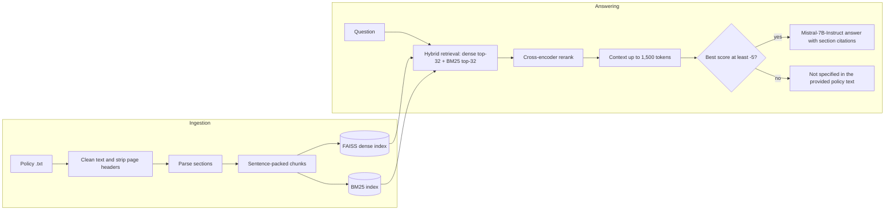

# Insurance Policy RAG

[](https://colab.research.google.com/github/YOUR-GITHUB-USERNAME/insurance-policy-rag/blob/main/insurance_policy_rag.ipynb)

[](LICENSE)

Grounded question answering over a health insurance policy document (HDFC ERGO **my:Optima Secure**).
The system answers only from the policy text, cites the sections it used, and replies
*"Not specified in the provided policy text."* when the policy does not cover the question.

The whole pipeline lives in one Jupyter notebook and runs on a free Google Colab T4 GPU.

## Highlights

- **Section-aware parsing** finds headings even when they occur mid-line, and rejects cross-references ("under Section 3.1") by requiring section numbers to only ever advance.
- **Sentence-packed chunks** (300 tokens, 600 for plan-comparison tables) with one-sentence overlap never split a sentence, so amounts like ₹2,00,00,000 stay intact. Each chunk is indexed together with its section label.
- **Hybrid retrieval** combines dense search (`bge-small-en-v1.5` + FAISS) with BM25. The union of both top-32 lists is reranked by the `bge-reranker-base` cross-encoder.
- **Budgeted context** is filled best-first up to a hard 1,500-token cap, section labels included.
- **Refusal gate** answers only when the best reranker score is at least −5.0.
- **LangGraph orchestration** runs `retrieve → rerank → gate → answer | no_answer`.
- **T4-friendly memory handling** includes allocator tuning, cache release between stages, an automatic retry with a smaller context on CUDA out-of-memory, and optional 4-bit loading.
- **Built-in evaluation** covers a gold set, a gate-threshold sweep, a regression check against the original notebook's evidence, and a prompt A/B test.

## How it works



| Stage | Model or method |
|---|---|
| Embeddings | [`BAAI/bge-small-en-v1.5`](https://huggingface.co/BAAI/bge-small-en-v1.5), FAISS `IndexFlatIP` (exact search) |
| Lexical search | BM25 (`rank-bm25`) |
| Reranking | [`BAAI/bge-reranker-base`](https://huggingface.co/BAAI/bge-reranker-base) |
| Generation | [`mistralai/Mistral-7B-Instruct-v0.3`](https://huggingface.co/mistralai/Mistral-7B-Instruct-v0.3), fp16, greedy decoding |
| Orchestration | LangGraph `StateGraph` |

## Repository structure

```
insurance-policy-rag/
├── insurance_policy_rag.ipynb   # the complete pipeline (v2.2)
├── requirements.txt             # dependencies for local runs
├── data/
│   └── README.md                # how to obtain and place the policy text
├── .gitignore                   # keeps the policy text and generated index out of git
├── LICENSE
└── README.md
```

The notebook is organized in numbered sections. Sections 1–4 build the index (ingestion), Sections 5–9 answer questions (serving), and Section 10 holds the evaluation tools.

## Requirements

- **A CUDA GPU with about 15 GB of memory** for Mistral-7B in fp16. A Colab T4 is enough. On smaller GPUs, set `CONFIG["llm_load_in_4bit"] = True` (about 4 GB).
- **About 15 GB of model downloads** on first run, mostly the Mistral weights. The three models are public on Hugging Face, so no account or token is required.
- **The policy text** as a UTF-8 `.txt` file. It is not included in this repository; see [`data/README.md`](data/README.md).

## Quick start on Google Colab

1. Click **Open in Colab** above. The notebook is saved with a T4 GPU runtime; confirm it under *Runtime → Change runtime type*.
2. Choose *Runtime → Run all*.
3. When Section 1 shows a file picker, upload your policy `.txt` file.

Answers appear in Section 9 and evaluation tables in Section 10. *Run all* generates up to 27 answers (Sections 9, 10 and 10.1), so it takes a while. To ask your own questions instead, run up to Section 8 and call `ask(...)`.

The first cell installs the dependencies Colab does not already have.

*Optional:* add a Hugging Face token as a Colab secret named `HF_TOKEN` (key icon in the left sidebar) and allow access when Colab asks. This avoids anonymous download rate limits.

## Local setup

Requires Python 3.12 and a CUDA GPU (see [Requirements](#requirements)).

```bash
git clone https://github.com/YOUR-GITHUB-USERNAME/insurance-policy-rag.git
cd insurance-policy-rag

python3.12 -m venv .venv          # Windows: py -3.12 -m venv .venv
source .venv/bin/activate         # Windows: .venv\Scripts\activate
pip install --upgrade pip

# 1. PyTorch: install the build for your CUDA version (see https://pytorch.org/get-started/locally/)
pip install torch

# 2. Everything else
pip install -r requirements.txt
```

Then:

1. Put the policy text at `data/policy.txt` (see [`data/README.md`](data/README.md)).
2. Start Jupyter from the repository root: `jupyter lab insurance_policy_rag.ipynb`.
3. In Section 1, change `SOURCE_PATH = None` to `SOURCE_PATH = "data/policy.txt"`.
4. Choose *Run → Run All Cells*.

The notebook's first cell repeats a `pip install`. In this environment every package is already satisfied, so nothing changes.

*Optional:* `export HF_TOKEN=hf_...` or `hf auth login` to download models with your Hugging Face account.

## Asking questions

After Section 8 has run:

```python
result = ask("What is the waiting period for pre-existing diseases?")
```

`ask()` prints the source sections with their reranker scores, the context size and the answer. It returns the pipeline state as a dict with the keys `query`, `retrieved`, `reranked`, `scores` and `answer`.

## Configuration

Every setting is in the `CONFIG` dictionary in Section 0.1. These are the ones most often changed:

| Key | Default | Controls |
|---|---|---|
| `chunk_size_tokens` / `table_chunk_tokens` | `300` / `600` | Chunk size for normal and table-like sections |
| `k_dense` / `k_bm25` | `32` / `32` | Candidates from each retrieval leg; their union is reranked |
| `context_token_budget` | `1500` | Hard cap on context size, section labels included |
| `rerank_score_threshold` | `-5.0` | Refuse when the best reranker score is below this |
| `max_new_tokens` | `1000` | Maximum answer length |
| `use_chat_template` | `True` | Mistral chat template (`True`) or the original raw prompt (`False`) |
| `llm_load_in_4bit` | `False` | 4-bit loading for GPUs with less memory |
| `embed_model` / `reranker_model` / `llm_model` | see above | Hugging Face model IDs |

Changes to chunking, retrieval, context size, the threshold or the prompt change the answers. Rerun Section 10 after any change.

## Evaluation

| Tool | Where | What it reports |
|---|---|---|
| `evaluate()` | Section 10 | Per gold question: section recall, expected-keyword hits, routing (answer or refusal), top reranker score, context size. Includes a negative control that should be refused. |
| `sweep_thresholds()` | Section 10 | Routing at several gate thresholds. Pick the highest threshold that still answers every answerable question and refuses the negative control. |
| `regression_check()` | Section 10.1 | How much of the evidence used by the original notebook's answers is present in each new context (target ≥ 0.90), plus answer grounding. |
| `generation_ab()` | Section 10.2 | The same contexts answered with three prompt variants. Runs about 3× the LLM calls, so it is not called by default. |

The gold set and the regression fixture are specific to the my:Optima Secure document.

## Using a different policy document

The pipeline is general, but a few parts are tuned to this document:

- `PAGE_HEADER_PATTERNS` (Section 1) lists the repeated page header lines to strip.
- `looks_like_table()` (Section 3) recognizes plan-comparison tables by this policy's plan names.
- `GOLD` (Section 10) and `ORIGINAL_EVIDENCE` (Section 10.1) hold questions and evidence for this policy.

Always check the section ladder printed in Section 2.1 before going further: everything downstream depends on it.

## Generated files

Section 4.2 writes `policy_index.faiss` and `chunks.json` to the working directory, and its comments show how to reload them without re-ingesting. Both files are ignored by git.

## Troubleshooting

| Symptom | Fix |
|---|---|
| `CUDA out of memory` | Restart the runtime (*Runtime → Restart session*) and run from the top: the memory setting in the first cell only applies before PyTorch first uses the GPU. If the `[GPU …]` line after model loading shows little free memory, or warns that LLM modules were placed on CPU or disk, set `CONFIG["llm_load_in_4bit"] = True`, then rerun Section 10.1 to confirm answer quality. |
| `AssertionError: Set SOURCE_PATH to your policy .txt file` | Outside Colab there is no upload dialog. Set `SOURCE_PATH` in Section 1. |
| Sections missing from the ladder in Section 2.1 | A page header may be splitting a heading. Add it to `PAGE_HEADER_PATTERNS`, or add the word that precedes the heading to `REF_WORDS`. |
| Warning: `` `torch_dtype` is deprecated! Use `dtype` instead! `` | Harmless with recent `transformers`. The model is still loaded in fp16. |
| Slow or rate-limited model downloads | Set a Hugging Face token (`HF_TOKEN`). |

## Version history

- **v2.2 (current):** fixes for CUDA out-of-memory on a Colab T4.
- **v2.1:** fixes for an answer-quality regression against the original notebook, with a regression check to measure it.

The notebook's first cell lists every change with its measured cause.

## Limitations

- Answers are generated by a language model from retrieved excerpts. They can be incomplete or wrong, so check them against the policy wording. This project does not give insurance advice.
- One policy document per index.
- Generation needs a GPU in practice.

## License

The code is released under the [MIT License](LICENSE).

The models are downloaded from Hugging Face under their own licenses: `bge-small-en-v1.5` and `bge-reranker-base` (MIT), `Mistral-7B-Instruct-v0.3` (Apache 2.0).

The my:Optima Secure policy document belongs to HDFC ERGO General Insurance Company Limited. It is not distributed with this repository.
