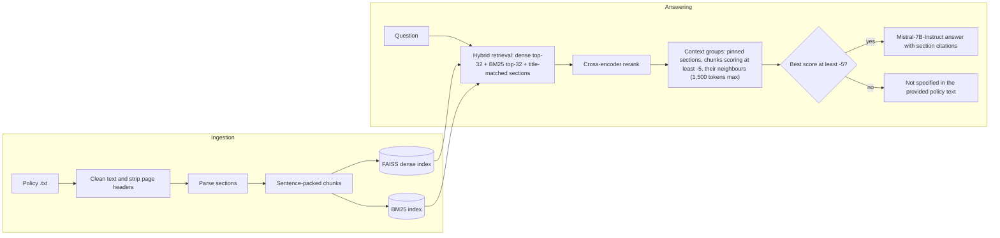

# Insurance Policy RAG

[](https://colab.research.google.com/github/RamkrushnaSaner/insurance-policy-rag/blob/main/insurance_policy_rag.ipynb)

[](LICENSE)

Grounded question answering over a health insurance policy document (HDFC ERGO **my:Optima Secure**).
The system answers only from the policy text, cites the sections it used, and replies
*"Not specified in the provided policy text."* when the policy does not cover the question.

The whole pipeline lives in one Jupyter notebook and runs on a free Google Colab T4 GPU.

## Highlights

- **Section-aware parsing** finds headings even when they occur mid-line, and rejects cross-references ("under Section 3.1") by requiring section numbers to only ever advance.
- **Sentence-packed chunks** (300 tokens, 600 for plan-comparison tables) with one-sentence overlap never split a sentence, so amounts like ₹2,00,00,000 stay intact. Each chunk is indexed together with its section label.
- **Hybrid retrieval** combines dense search (`bge-small-en-v1.5` + FAISS) with BM25. The union of both top-32 lists is reranked by the `bge-reranker-base` cross-encoder. BM25 can be switched off (`use_bm25`) to measure what it adds.
- **Title pinning**: when a section heading appears in the question ("Plus Benefit", "Standard Exclusions"), that section and its sub-sections go into the context first.
- **Neighbour expansion**: a selected chunk brings the text it depends on, such as the list that follows "…provided below", its parent heading, or the next year's plan table. Each group reaches the model as one labelled passage.
- **Budgeted context** under a hard 1,500-token cap, section labels included. Reranked chunks scoring below −5.0 are not used as filler.
- **Scope rules in the prompt** stop the model from applying one cover's conditions or lists to another (switchable for A/B testing).
- **Refusal gate** answers only when the best reranker score is at least −5.0.
- **LangGraph orchestration** runs `retrieve → rerank → gate → answer | no_answer`.
- **T4-friendly memory handling** includes allocator tuning, cache release between stages, an automatic retry with a smaller context on CUDA out-of-memory, and optional 4-bit loading.
- **Evaluation workflow** with no API keys: a 94-question test set checked against the policy text (10 question types, including everyday wording, out-of-scope questions and false premises); metrics for retrieval, answer correctness, faithfulness (figures and section numbers the context does not contain) and reliability; retrieval-only and full experiment modes; paired comparisons with bootstrap intervals; saved runs that reload in a later session. See [`docs/improvement_plan.md`](docs/improvement_plan.md) for the baseline findings and roadmap.
- **Earlier evaluation tools** cover the original 10-question gold set, a gate-threshold sweep, a regression check against the original notebook's evidence, and a prompt A/B test.
## How it works



| Stage | Model or method |
|---|---|
| Embeddings | [`BAAI/bge-small-en-v1.5`](https://huggingface.co/BAAI/bge-small-en-v1.5), FAISS `IndexFlatIP` (exact search) |
| Lexical search | BM25 (`rank-bm25`) |
| Reranking | [`BAAI/bge-reranker-base`](https://huggingface.co/BAAI/bge-reranker-base) |
| Generation | [`mistralai/Mistral-7B-Instruct-v0.3`](https://huggingface.co/mistralai/Mistral-7B-Instruct-v0.3), fp16, greedy decoding |
| Orchestration | LangGraph `StateGraph` |

## Example

Output recorded from a run of v2.2. `Sources` lists the chunks given to the model, as `section (reranker score)`, best first.

**Q:** What is the procedure for cashless claims in India? Give me step wise complete procedure.

`Sources: 11.2 (3.69), 11.3 (1.28), 11.5 (-0.73), 11 (-2.34), 11.4 (-2.48), 4.9.1 (-2.97), 4.10.1 (-3.63)`<br>
`Context tokens: 1283`

**A:** The procedure for cashless claims in India, as specified in the policy text, is as follows:

1. Treatment may be taken in a Network Provider (Section 11.2.a).
2. The Insured Person or Policyholder should obtain a Cashless request form from the Network Provider (Section 11.2.b).
3. The Network Provider shall gather relevant information from the Insured Person/Policyholder and send a Cashless Facility request to the Company for authorization (Section 11.2.c).
4. The Company, upon receiving the cashless request form and related medical information, will issue a pre-authorization letter to the Network Provider after verification (Section 11.2.d).
5. At the time of discharge, the Insured Person shall verify and sign the discharge papers along with the final bill, pay for non-medical and inadmissible expenses (Section 11.2.e).
6. In case the Insured Person is unable to provide the relevant medical details, the Company reserves the right to deny pre-authorization (Section 11.2.f).
7. If cashless access is denied, the Insured Person may obtain treatment as per the treating doctor's advice and submit the claim documents to the Company for reimbursement (Section 11.2.g).
8. It is important to note that the pre-authorization issued by the Company is valid for 15 days from the date of issuance (or expiry of the Policy, whichever is earlier) (Section 11.5.c).
9. The Company shall make payment for the Cashless facility to the authorized amount, directly to the Network Provider (Section 11.5.d).
10. The Insured Person should check the updated list of Network Providers before applying for cashless claim, as the Company reserves the right to modify, add, or restrict any Network Provider for Cashless facility at its sole discretion (Section 11.5.b).

More recorded answers, covering plan comparison, exclusions, waiting periods, claims, pre- and post-hospitalization expenses and the Plus Benefit, are in [`examples/sample_outputs.md`](examples/sample_outputs.md).

## Repository structure

```
insurance-policy-rag/
├── insurance_policy_rag.ipynb   # the complete pipeline (v2.6)
├── requirements.txt             # dependencies for local runs
├── data/
│   └── README.md                # how to obtain and place the policy text
├── docs/
│   └── improvement_plan.md      # baseline findings, recommendations, path to agentic behaviour
├── evaluation/
│   ├── insurance_policy_rag_v2_6_eval_run.ipynb   # pipeline + one-pass evaluation run (Section 12)
│   └── insurance_policy_rag_v2_6_eval_t4.ipynb    # the same, set up for a Colab T4 (LLM in 4-bit)
├── examples/
│   └── sample_outputs.md        # recorded answers to eight policy questions (v2.2 run)
├── .gitignore                   # keeps the policy text and generated index out of git
├── LICENSE
└── README.md
```

The notebook is organized in numbered sections. Sections 1–4 build the index (ingestion), Sections 5–9 answer questions (serving), and Section 10 holds the evaluation tools. The test set, the evaluation workflow and the experiments are in Sections 10.3 to 10.5.

## Requirements

- **A CUDA GPU.** Mistral-7B in fp16 needs about 15 GB. On a Colab T4 the fp16 model and the reranker together can leave part of the model on the CPU, and each answer then takes several minutes; set `CONFIG["llm_load_in_4bit"] = True` there and on smaller GPUs (about 4 GB).
- **About 15 GB of model downloads** on first run, mostly the Mistral weights. The three models are public on Hugging Face, so no account or token is required.
- **The policy text** as a UTF-8 `.txt` file. It is not included in this repository; see [`data/README.md`](data/README.md).

## Quick start on Google Colab

1. Click **Open in Colab** above. The notebook is saved with a T4 GPU runtime; confirm it under *Runtime → Change runtime type*.
2. Choose *Runtime → Run all*.
3. When Section 1 shows a file picker, upload your policy `.txt` file.

Answers appear in Section 9 and evaluation tables in Section 10. *Run all* generates up to 30 answers (Sections 9, 10 and 10.1) and runs 13 retrieval experiments over 94 questions (Section 10.5, about 15–20 minutes), so it takes a while. To ask your own questions instead, run up to Section 8 and call `ask(...)`.

The first cell installs the dependencies Colab does not already have.

*Optional:* add a Hugging Face token as a Colab secret named `HF_TOKEN` (key icon in the left sidebar) and allow access when Colab asks. This avoids anonymous download rate limits.

## Local setup

Requires Python 3.12 and a CUDA GPU (see [Requirements](#requirements)).

```bash
git clone https://github.com/RamkrushnaSaner/insurance-policy-rag.git
cd insurance-policy-rag

python3.12 -m venv .venv          # Windows: py -3.12 -m venv .venv
source .venv/bin/activate         # Windows: .venv\Scripts\activate
pip install --upgrade pip

# 1. PyTorch: install the build for your CUDA version (see https://pytorch.org/get-started/locally/)
pip install torch

# 2. Everything else
pip install -r requirements.txt
```

Then:

1. Put the policy text at `data/policy.txt` (see [`data/README.md`](data/README.md)).
2. Start Jupyter from the repository root: `jupyter lab insurance_policy_rag.ipynb`.
3. In Section 1, change `SOURCE_PATH = None` to `SOURCE_PATH = "data/policy.txt"`.
4. Choose *Run → Run All Cells*.

The notebook's first cell repeats a `pip install`. In this environment every package is already satisfied, so nothing changes.

*Optional:* `export HF_TOKEN=hf_...` or `hf auth login` to download models with your Hugging Face account.

## Asking questions

After Section 8 has run:

```python
result = ask("What is the waiting period for pre-existing diseases?")
```

`ask()` prints the source sections with their reranker scores, the context size, and the answer. It returns the pipeline state as a dict with the keys `query`, `retrieved`, `reranked`, `scores`, `groups`, `top_score` and `answer`, plus `error` when a step failed and `oom_retry` when the answer came from the shortened out-of-memory retry.

## Configuration

Every setting is in the `CONFIG` dictionary in Section 0.1. These are the ones most often changed:

| Key | Default | Controls |
|---|---|---|
| `chunk_size_tokens` / `table_chunk_tokens` | `300` / `600` | Chunk size for normal and table-like sections |
| `k_dense` / `k_bm25` | `32` / `32` | Candidates from each retrieval leg; their union is reranked |
| `use_bm25` | `True` | `False` = dense search only; switch off only if the `dense_only` experiments show no loss |
| `context_token_budget` | `1500` | Hard cap on context size, section labels included |
| `title_pinning` | `True` | Put sections whose heading appears in the question first |
| `neighbour_expansion` | `True` | Add the chunk a selected chunk continues into or depends on |
| `seed_score_floor` | `-5.0` | Reranked chunks below this are not used to fill the context |
| `title_pinning_rules` | `"v2.3"` | `"v2.5"` = precise title pinning (fixes unrelated sections being pinned); switch on after the experiment run confirms it |
| `continuation_sections` | `False` | Sections that only continue the previous one (the Cumulative Bonus notes, 3.9 and 3.10) travel with it and get its name as label; switch on after the experiment run confirms it |
| `bm25_stemming` | `False` | Stem words for BM25 ("notified" matches "notification"); switch on after the experiment run confirms it |
| `prompt_version` | `"v2.3"` | Prompt with scope rules (`"v2.3"`) or the original instructions (`"original"`) |
| `rerank_score_threshold` | `-5.0` | Refuse when the best reranker score is below this |
| `max_new_tokens` | `1000` | Maximum answer length |
| `use_chat_template` | `True` | Mistral chat template (`True`) or the original raw prompt (`False`) |
| `llm_load_in_4bit` | `False` | 4-bit loading for GPUs with less memory |
| `embed_model` / `reranker_model` / `llm_model` | see above | Hugging Face model IDs |

Changes to chunking, retrieval, context size, the threshold or the prompt change the answers. Rerun Section 10 after any change.

## Evaluation

| Tool | Where | What it reports |
|---|---|---|
| `evaluate()` | Section 10 | Per gold question (nine answerable, including the 24-month list, standard exclusions and the plan comparison): section recall, expected-keyword hits, routing (answer or refusal), top reranker score, context size. Includes a negative control that should be refused. |
| `sweep_thresholds()` | Section 10 | Routing at several gate thresholds. Pick the highest threshold that still answers every answerable question and refuses the negative control. |
| `regression_check()` | Section 10.1 | How much of the evidence used by the original notebook's answers is present in each new context (target ≥ 0.90), plus answer grounding. |
| `generation_ab()` | Section 10.2 | The same contexts answered with the original raw prompt, the v2.2 prompt and the v2.3 prompt with scope rules. Runs about 3× the LLM calls, so it is not called by default. |

The gold set, the test set and the regression fixture are specific to the my:Optima Secure document.

### Test set and evaluation workflow (Sections 10.3–10.5)

The test set has 94 questions written from the policy text: facts, lists, conditions, definitions, procedures, comparisons, questions spanning several sections, 24 questions in everyday wording, 7 out-of-scope questions and 3 false premises. Each has gold sections, key facts (with alternative phrasings) and a reference answer. `check_testset()` verifies them against the loaded policy.

`run_experiment(name, overrides, mode)` answers all 94 questions with the given `CONFIG` overrides, scores every answer, saves the run to `eval_runs/` and restores the settings afterwards.

| Mode | What runs | Time on a T4 | Main metric |
|---|---|---|---|
| `retrieval` | Retrieve, rerank, build the context, gate (no LLM) | about 1–2 minutes | `ctx_fact_recall`: share of key facts that reach the model |
| `full` | The whole pipeline | about 30–45 minutes | `answer_fact_recall`: share of key facts in the answer |

Other metrics: gold sections in the context and among the candidates, MRR of the first gold chunk, gate decisions on answerable and out-of-scope questions, false refusals, correct refusals, **faithfulness** (`unsupported_figures`: amounts, percentages and durations in the answer that are in neither the context nor the question; `unsupported_citations`: section numbers cited that the context does not contain; `grounding`), **reliability** (pipeline errors, out-of-memory retries) and context size. `scorecard(run)` shows them grouped.

`compare_runs(baseline, experiment)` pairs the runs question by question and reports the mean difference with a 95% bootstrap interval, calling a change *better* or *worse* only when the interval excludes zero. `regressions()` lists the questions that got worse, and `routing_sweep()` re-tunes the gate from saved scores.

*Run all* runs 13 retrieval experiments by default: the baseline, ablations of the v2.3 context changes, the three fixes alone and together, three BM25 experiments (`dense_only`, `dense_only_k64`, `bm25_only`) and a larger context. Add full-mode runs with `EVAL_PLAN["full"] = ["baseline", ...]`, and model swaps (`reranker_v2_m3`, `embed_bge_base`) in a session with `CONFIG["llm_load_in_4bit"] = True`. In Colab, `export_runs()` downloads the saved runs, which otherwise disappear when the runtime is recycled; in a later session `upload_runs()` restores them and `load_run_file()` loads a saved baseline for comparison. Comparisons warn when two runs used different test-set versions.

### Evaluation-run notebooks (`evaluation/`)

Both notebooks contain the full v2.6 pipeline plus Section 12, which collects one complete set of results: an environment record (package versions, models, GPU, policy file hash), health checks (test set against the policy, prompt sizes, repeat runs for determinism), full answers with checkpoints that resume after a disconnect, and a results zip with `report.md` and CSV summaries. `insurance_policy_rag_v2_6_eval_t4.ipynb` loads the LLM in 4-bit by default and adds run settings at the top (Section 0.2) and a generation speed check (Section 12.1), for a Colab T4. Neither notebook changes the system's behaviour.

## Using a different policy document

The pipeline is general, but a few parts are tuned to this document:

- `PAGE_HEADER_PATTERNS` (Section 1) lists the repeated page header lines to strip.
- `looks_like_table()` (Section 3) recognizes plan-comparison tables by this policy's plan names.
- Title pinning (Section 6.1) relies on the section titles parsed in Section 2.2; check them in the ladder output.
- `GOLD` (Section 10) and `ORIGINAL_EVIDENCE` (Section 10.1) hold questions and evidence for this policy.

Always check the section ladder printed in Section 2.1 before going further: everything downstream depends on it.

## Generated files

Section 4.2 writes `policy_index.faiss` and `chunks.json` to the working directory, and its comments show how to reload them without re-ingesting. Both files are ignored by git.

## Troubleshooting

| Symptom | Fix |
|---|---|
| `CUDA out of memory` | Restart the runtime (*Runtime → Restart session*) and run from the top: the memory setting in the first cell only applies before PyTorch first uses the GPU. If the `[GPU …]` line after model loading shows little free memory, or warns that LLM modules were placed on CPU or disk, set `CONFIG["llm_load_in_4bit"] = True`, then rerun Section 10.1 to confirm answer quality. |
| `AssertionError: Set SOURCE_PATH to your policy .txt file` | Outside Colab there is no upload dialog. Set `SOURCE_PATH` in Section 1. |
| Sections missing from the ladder in Section 2.1 | A page header may be splitting a heading. Add it to `PAGE_HEADER_PATTERNS`, or add the word that precedes the heading to `REF_WORDS`. |
| Warning: `` `torch_dtype` is deprecated! Use `dtype` instead! `` | Harmless with recent `transformers`. The model is still loaded in fp16. |
| Slow or rate-limited model downloads | Set a Hugging Face token (`HF_TOKEN`). |

## Version history

- **v2.6 (current):** BM25 switch (`use_bm25`); a continuation-sections fix (off by default); evaluation workflow without API keys, with faithfulness and reliability metrics and baselines that reload across sessions; pipeline errors and out-of-memory retries recorded in the state; test set extended to 94 questions. RAGAS and Langfuse are set aside until this workflow is reliable. Answers are unchanged from v2.3 with the default settings.
- **v2.5:** evaluation framework: a 92-question test set, an experiment runner with retrieval-only and full modes, paired comparisons, and two measured fixes (precise title pinning, stemmed BM25) that stay off until the experiment run confirms them. Answers are unchanged from v2.4 with the default settings.
- **v2.4:** optional RAGAS scoring and Langfuse tracing (kept in that version for later use). Answers are unchanged from v2.3.
- **v2.3:** answer-quality fixes traced from the recorded v2.2 answers: title pinning, neighbour expansion, a relevance floor for context filler, scope rules in the prompt, and cleaner section titles.
- **v2.2:** fixes for CUDA out-of-memory on a Colab T4.
- **v2.1:** fixes for an answer-quality regression against the original notebook, with a regression check to measure it.

The notebook's first cell lists every change with its measured cause.

## Limitations

- Answers are generated by a language model from retrieved excerpts. They can be incomplete or wrong, so check them against the policy wording. This project does not give insurance advice.
- One policy document per index.
- Generation needs a GPU in practice.

## License

The code is released under the [MIT License](LICENSE).

The models are downloaded from Hugging Face under their own licenses: `bge-small-en-v1.5` and `bge-reranker-base` (MIT), `Mistral-7B-Instruct-v0.3` (Apache 2.0).

The my:Optima Secure policy document belongs to HDFC ERGO General Insurance Company Limited. It is not distributed with this repository.
