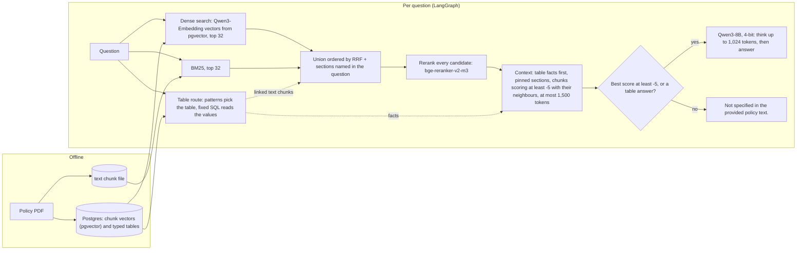

# Insurance Policy RAG

[](https://colab.research.google.com/github/RamkrushnaSaner/insurance-policy-rag/blob/main/notebooks/colab_quickstart.ipynb)

[](LICENSE)

This system answers questions about a health insurance policy (HDFC ERGO **my:Optima Secure**) from the policy text
only. It cites the sections it used. When the text does not cover a question, it replies *"Not specified in the
provided policy text."* Everything runs on open models on a free Colab T4 GPU, with no API keys. The repository also
holds the evaluation that measured the system, every experiment and the published results.

There are two configurations:

- **v3.4, adopted:** [`configs/experiments/qwen3_text_tables.yaml`](configs/experiments/qwen3_text_tables.yaml). It
  searches with Qwen3 vectors stored in Postgres (pgvector) and answers table questions from typed tables with fixed
  SQL. It needs a database; see [`db/`](db/).
- **The baseline:** [`configs/default.yaml`](configs/default.yaml), which needs no database. It was the first published
  system and is still the package default.

> The answers come from a language model. They can be incomplete or wrong, so check them against the policy wording.
> This project does not give insurance advice.

## Results

**v3.4 answers 77.5% of new questions fully correctly** (255 of 329, 95% CI 73–82%). The questions come in four sets,
written after the system was built and never used to tune it. On the 113 development questions, which every change
was tuned or decided on, the same system scores 89.4%. An answer counts as **fully correct** when:
- it contains every key fact;
- it has no critical error (a wrong table value, a known false statement, another cover's rule, a figure that is not
  in the context, a wrong yes/no);
- it is not cut off.

For a question the policy does not answer, it must say so at the start.

| Question set | Questions | Fully correct | 95% CI | Table questions | Text questions |
|---|---|---|---|---|---|
| Development (tuned on) | 113 | 101 (89.4%) | 82–94% | 6/8 | 76/86 |
| Fresh v1 | 72 | 55 (76.4%) | 65–85% | 6/11 | 41/53 |
| Fresh v2 | 62 | 44 (71.0%) | 59–81% | 5/14 | 33/42 |
| Fresh v3 | 107 | 88 (82.2%) | 74–88% | 18/29 | 63/71 |
| Fresh v4 | 88 | 68 (77.3%) | 67–85% | 20/30 | 40/50 |
| **All fresh** | **329** | **255 (77.5%)** | **73–82%** | **49/84 (58%)** | **177/216 (82%)** |

**What works.**
- **Finding text:** the first search stage finds 99% of the passages that hold an answer printed in the text, and the
  reranker puts 84% of them first.
- **Declining:** all 29 questions the policy does not answer were declined.
- **Sources:** 93% of answers cite a section, and no answer cites a section it was not given.
- **Numbers:** one answer in 311 has a figure that is not in its context, and that figure is a correct subtraction.
- **Stability:** no errors in 442 questions, and repeated search and regenerated answers were identical.

**Where it fails.**
- **Table questions:** only 58% are fully correct. Every failure lost in search is a fact printed only in a table
  that the hand-written table lookup did not return (26).
- **Declined answers:** 17% of answerable questions get an answer that opens by saying the policy does not give the
  answer.
- **Where the 76 failures counted by the checks started:** 34 in the answer itself, 26 in search, 15 in choosing what
  the model reads, and 1 at the relevance gate. Read one by one, 17 of the 34 answer-stage failures are clear model
  errors. In those, the model opened with the refusal sentence although it then applied the right rule, or missed a
  qualifier in front of it.
- **Speed:** a median of 43 s per answer on a T4.

[docs/final_evaluation.md](docs/final_evaluation.md) has the full evaluation: metrics, failure analysis, root causes,
readiness and recommendations. [results/final_evaluation/](results/final_evaluation/) has every number per question
and per set.

### Experiments

| # | Experiment | Result | Decision | Evidence |
|---|---|---|---|---|
| 1 | Baseline on the development set | 79/88 fully correct on its test split | the first published system | [results/baseline/](results/baseline/) |
| 3 | v2.6 (Mistral-7B, text chunks) against v3.1, 24 dev questions | 11 → 17 fully correct, 6 fixed, 0 broken (p = 0.031) | v3 kept | [results/v2_6_vs_v3_1/](results/v2_6_vs_v3_1/) |
| 4 | Reproduction on a T4, three sessions | identical contexts, prompts, verdicts and groundedness each time | – | [results/reproduction/](results/reproduction/) |
| 5 | Thinking off | 72/88: 7 lost, 0 gained (p = 0.016); median 9.5 s instead of 47.4 s | keep thinking on | [results/thinking_off/](results/thinking_off/) |
| 6 | Conversation memory, three runs | never significantly better (final run: 21 vs 19 of 32 follow-ups, p = 0.73) | off by default | [results/memory/](results/memory/) |
| 7 | Qwen3 embeddings from Neon (pgvector), text-only chunks | all evidence in context 64/67 for both embedders; dense recall@10 0.955 → 0.993 | keep Qwen3 | [results/embedder_qwen3/](results/embedder_qwen3/) |
| 8 | Table route (typed tables in Postgres), retrieval | table-only questions with every key fact in context 0/12 → 12/12; nothing lost elsewhere | tables on | [results/table_route_retrieval/](results/table_route_retrieval/) |
| 9 | **Neon + table route, full answers (v3.4)** | 78/88 against 79/88 (5 fixed, 6 broken, p = 1.0); 100/113 overall | **adopted**: not worse, not shown better | [results/neon_tables/](results/neon_tables/) |
| 10 | R1 (a search card for every table row) against v3.4, fresh v3, graded by the checks | 94 vs 88 of 107; table questions 26 vs 18 (p = 0.02); the checks agreed with a person at kappa 0.52, below the 0.7 required | not adopted | [docs/experiments.md](docs/experiments.md#10-r1-table-cards-on-fresh-v3) |
| 11 | R1 against v3.4, final round, fresh v4, the deciding answers judged by a person | table questions 24 vs 20 (6 fixed, 2 broken, p = 0.29); text 42 vs 40 | **not adopted: v3.4 stays**; the last decision | [docs/experiments.md](docs/experiments.md#11-final-round-r1-against-v34-on-fresh-v4) |
| 12 | **Evaluation of v3.4 on every question set** | 255/329 = 77.5% on new questions; 101/113 on the development set | – | [results/final_evaluation/](results/final_evaluation/) |

Experiment 2 corrected the checks before any of this. [docs/experiments.md](docs/experiments.md) explains each
experiment (objective, method, result, limitations) and lists what has not been run or cannot be verified. Every
result folder names the private run files it was built from (sha256), and
[`tests/test_published_results.py`](tests/test_published_results.py) recomputes the headline numbers from the
published files.

**The development set (113 questions).** Experiments 1–9 were measured on it. It has 25 dev and 88 "test" questions,
and the test split decided experiments 5, 7, 8 and 9. Its numbers are optimistic for two reasons: the whole set was read during
development, and the table patterns were written with it in view. The baseline's 79/88 (89.8%) on the test split is
not a measure of accuracy on new questions. [docs/evaluation.md](docs/evaluation.md) has the baseline's full results
and every failure.

**The last candidate, R1, was not adopted.** R1 adds a search card for every row of every printed table (code on the
branch `r1-candidate`). It was judged twice on questions written after it was built, under rules fixed and
fingerprinted before any answer existed. On both sets it removed every failure where a fact printed only in a table
never reached the model (6 → 0 and 7 → 0). The answers improved too, but not by enough: on fresh v3 the checks could
not be trusted (they passed a clearly wrong answer), and on fresh v4, judged by a person, the gain on table questions
(6 fixed, 2 broken) was not significant; 10 fixed against 2 broken would have been needed.

**How far to trust these numbers**

- **The questions:** the four fresh sets and their answer keys were written by the AI assistant that built the system,
  and checked mechanically. They are kept private because they quote the policy; their fingerprints are in
  [results/final_evaluation/source.json](results/final_evaluation/source.json).
- **The checks:** they are rules that match the answer against an answer key with alternative phrasings. They look
  for the key words, not for what the answer claims. Against a person's blind labels they agreed at kappa 0.75 on
  v3.4's 33 labelled answers in fresh v4, 0.63 on all 66 labelled answers of that round, and 0.52 on 30 answers of
  another system in fresh v3. The checks were repaired on 12 November 2026 (amount abbreviations, unit-less ages,
  word forms, hedged openings). Results before that date keep the verdicts of their time. On the development set,
  the repair changes one v3.4 verdict (100 → 101 of 113).
- **How precise:** 329 questions give a 95% interval of about ±4–5 points. The 84 table questions give about ±10
  points. A difference between two systems on one set of about 100 questions has to be large to show.
- **Groundedness (HHEM):** it is not usable as a hallucination rate here. It flags at least one sentence in 50% of
  v3.4's answers, but it also flags 29% of the answers a person judged correct.

## How it works

The adopted configuration (v3.4):



The baseline ([`configs/default.yaml`](configs/default.yaml)) differs in three ways:
- its dense leg is bge-small-en-v1.5 with an in-memory FAISS index;
- its chunk file also holds the premium tables, searched as a separate index for cost questions;
- it has no table route.

Both can rewrite a follow-up question from the conversation (memory, off by default).

| Stage | What it does | Code |
|---|---|---|
| Chunking (offline) | Reads the PDF's two-column layout, finds numbered sections, lettered clauses and exclusion codes, and turns tables into self-describing lines (the baseline's chunk file) | [`ingest/optima_secure_pdf.py`](src/policy_rag/ingest/optima_secure_pdf.py) |
| Memory (off by default) | In a conversation, rewrites a follow-up into a complete question from the last 3 turns (one extra model call, thinking on). The answer prompt never contains the conversation. Evaluated three times and not adopted ([evaluation](docs/evaluation.md#conversation-memory)) | [`memory.py`](src/policy_rag/memory.py) |
| Search | Dense and BM25 legs, fused by reciprocal rank. Dense: [Qwen3-Embedding-0.6B](https://huggingface.co/Qwen/Qwen3-Embedding-0.6B) vectors read from Postgres (v3.4) or [BGE-small](https://huggingface.co/BAAI/bge-small-en-v1.5) with FAISS (baseline) | [`retrieval.py`](src/policy_rag/retrieval.py), [`database.py`](src/policy_rag/database.py) |
| Table route (v3.4) | Patterns pick the kind of table question, fields are checked against the tables, and parameterised SQL returns values traced to their printed cells | [`tables.py`](src/policy_rag/tables.py) |
| Reranking | A cross-encoder ([bge-reranker-v2-m3](https://huggingface.co/BAAI/bge-reranker-v2-m3)) scores every candidate | [`reranking.py`](src/policy_rag/reranking.py) |
| Context | Pins sections whose heading the question names, adds dependent neighbours ("the list below"), keeps a token budget | [`context.py`](src/policy_rag/context.py) |
| Gate | Refuses without calling the model when nothing relevant was found | [`pipeline.py`](src/policy_rag/pipeline.py) |
| Generation | [Qwen3-8B](https://huggingface.co/Qwen/Qwen3-8B) in 4-bit. It thinks first; at the budget it is told to answer. Sampling is seeded from the prompt, and answers are cached | [`generation.py`](src/policy_rag/generation.py), [`prompts.py`](src/policy_rag/prompts.py) |
| Evaluation | Deterministic checks, retrieval metrics, [HHEM-2.1-Open](https://huggingface.co/vectara/hallucination_evaluation_model) groundedness, paired statistics | [`evaluation/`](src/policy_rag/evaluation/) |

[docs/how_it_works.md](docs/how_it_works.md) follows one question through every stage and explains the reasoning
behind each design choice, with the measurements that led to it.

## Quick start

### On Google Colab (free T4 GPU)

Open [`notebooks/colab_quickstart.ipynb`](notebooks/colab_quickstart.ipynb) with the badge above, choose *Runtime →
Change runtime type → T4 GPU* and run the cells. It installs the package, asks for the policy PDF (or your chunk
file), and then lets you ask questions or run the evaluation.

### Locally (Linux with a CUDA GPU, about 16 GB)

```bash
git clone https://github.com/RamkrushnaSaner/insurance-policy-rag.git
cd insurance-policy-rag
python -m venv .venv && source .venv/bin/activate
pip install torch                       # the build for your CUDA version: https://pytorch.org/get-started/locally/
pip install -e ".[models,ingest]"

policy-rag chunk-pdf path/to/prospectus.pdf data/policy_chunks.json   # see data/README.md
policy-rag ask "What is the waiting period for pre-existing diseases?"
policy-rag chat                         # ask several questions in a row; /help lists the commands
```

The first answer downloads the models (roughly 20 GB; an estimate, not measured). From Python:

```python
from policy_rag import RAGSystem

rag = RAGSystem.from_config("configs/default.yaml")
r = rag.ask("Is a knee replacement after a road accident covered in the first year?")
r.answer, r.sources, r.route        # the answer, the passages it read, "answer" or "no_answer"

rag.set_memory(True)                # experimental follow-up rewriting (off by default, not adopted)
chat = rag.new_conversation()
rag.ask("What is the waiting period for kidney stones?", conversation=chat)
r = rag.ask("Does it apply if the problem is caused by an accident?", conversation=chat)
r.standalone                        # the complete question that was searched and answered
```

## Evaluate and experiment

```bash
policy-rag evaluate --name baseline                       # all 113 questions: about 2 hours on a T4
policy-rag evaluate --name baseline --splits dev          # 25 questions
policy-rag evaluate --name retr --mode retrieval          # search, rerank and context only: minutes, no answer model
policy-rag evaluate --name check --mode rescore --rescore-from runs/baseline/run.json   # re-check saved answers
```

Each run writes `runs/<name>/`: `report.md`, `results.csv` (every answer next to its reference),
`scorecard.csv`, `run.json` and `labels_to_fill.csv`. Answers are cached by prompt and generation settings, so
repeating a run, or running a variant that changes only retrieval for some questions, generates only what is new.
`--resume-from` reuses the answers of an earlier session: an `answer_cache.jsonl`, a results zip, or a run's
`run.json` (its records hold every generated answer). The cache keys are the same as the v3.1 notebook's, so its
answers can be reused here.

**Conversation memory** has its own evaluation: `policy-rag evaluate-dialogues --name memory` answers the 44
follow-ups in [`testsets/optima_secure_followups.json`](testsets/optima_secure_followups.json) three ways (as typed
without memory, rewritten by memory, and as the complete question) and applies a decision rule fixed in advance. In
three runs memory helped some follow-ups but never significantly (final run: 21 of 32 right with memory, 19 without;
5 fixed, 3 broken), so it is **switched off by default**. The write-up is in
[docs/evaluation.md](docs/evaluation.md#conversation-memory).


[`testsets/optima_secure_hard_questions.json`](testsets/optima_secure_hard_questions.json) has 15 harder questions
(calculations, combined conditions, traps) with expected answers to read side by side. They are not scored
automatically: `policy-rag ask --questions-file testsets/optima_secure_hard_questions.json --out runs/hard.csv`.

To run an experiment, change one thing in a config ([`configs/experiments/`](configs/experiments/)), or override a
setting on the command line, then compare with the baseline on the held-out split:

```bash
policy-rag evaluate --name budget_1536 --set generator.think_budget=1536
policy-rag compare runs/baseline/run.json runs/budget_1536/run.json --splits test
```

`compare` re-scores both runs with the same checks and runs McNemar's exact test on "fully correct", with paired
bootstrap intervals for the other metrics. It then applies the decision rule fixed in the config (`decision`): adopt
only if fully correct is significantly better on test, groundedness and abstention are not worse, and the median
answer time and peak GPU memory stay within budget. Models, prompt templates and whole components can be swapped
through the config; see [docs/extending.md](docs/extending.md).

## Project layout

```
insurance-policy-rag/
├── src/policy_rag/
│   ├── config.py          typed configuration (YAML, "extends", --set overrides)
│   ├── corpus.py          chunk files -> documents, sections, chunks (several documents supported)
│   ├── retrieval.py       dense + BM25 search, routed indexes, reciprocal rank fusion
│   ├── reranking.py       cross-encoder reranker
│   ├── context.py         title pinning, neighbour expansion, token budget, passage formatting
│   ├── prompts.py         prompt templates and the refusal text
│   ├── generation.py      answer model (two-phase thinking), answer cache
│   ├── memory.py          conversation memory: follow-up rewriting, conversations
│   ├── chat.py            the interactive chat loop
│   ├── pipeline.py        LangGraph pipeline and the RAGSystem entry point
│   ├── database.py        read-only Postgres session, stored-vector (pgvector) search
│   ├── tables.py          the table route: typed tables, fixed SQL, checks, traced values
│   ├── registry.py        component types selected by name in the config
│   ├── cli.py             the policy-rag command
│   ├── ingest/            PDF -> chunk file for the my:Optima Secure layout
│   └── evaluation/        test set, checks, groundedness, runner, report, statistics, comparison
├── configs/               default.yaml (the baseline), experiments/ (v3.4 and the experiment configs), a two-policy template
├── testsets/              the 113-question development set, follow-up dialogues (44, plus 2 practice sets), 15 hard questions
├── results/               published evidence, scores only: final_evaluation/ (v3.4 on every question set), and one
│                          folder per earlier experiment (see results/README.md)
├── db/                    the Postgres + pgvector schema (migrations; no policy text)
├── scripts/               export_results.py and export_final_evaluation.py: rebuild results/ from private run files
├── notebooks/             Colab quick start; archive/ = the single-notebook version (v3.2)
├── tests/                 241 tests with stand-in components and the published results (no GPU, no downloads;
│                          41 of them need a Postgres, run in CI)
├── docs/                  final evaluation, how it works, evaluation method, experiments, adding a policy, extending
└── data/                  your chunk file goes here (not in git; see data/README.md)
```

## Several policies

Each chunk file is a document with its own id (`documents` in the config). Section numbers, title pinning and
neighbour expansion are kept separate per document, and a question can be limited to some documents
(`--document <id>`, or `rag.ask(q, documents=[...])`). With more than one document loaded, every passage label starts
with the policy name and the prompt gets one extra rule: answer for the policy the question names, and say which
policy each statement comes from. With a single document the prompt is exactly the published one.
[`configs/two_policies.example.yaml`](configs/two_policies.example.yaml) is a template.

What is **not** there yet:

- a chunker for other PDF layouts (each insurer's documents need their own, writing the same fields; see
  [docs/adding_a_policy.md](docs/adding_a_policy.md));
- a test set for a second policy;
- any evaluation of choosing between policies. All results above are for one policy.

## Hardware and reproducibility

| | |
|---|---|
| GPU | Tested on a Tesla T4 (16 GB, free Colab). v3.4 peaked at 9.2–9.3 GB on the fresh sets; the baseline's published run at 10.3 GB (Qwen3-8B in 4-bit NF4, the reranker in fp16, HHEM). 4-bit loading needs a CUDA GPU (bitsandbytes). |
| CPU only | Chunking, retrieval-only evaluation, re-scoring and the tests run without a GPU. Generating answers on a CPU is impractically slow. |
| Downloads | Public Hugging Face models on the first run (roughly 20 GB, an estimate); no account or token needed. |
| Same answers again | Sampling is seeded from each prompt, so a prompt gives the same answer on the same hardware and software. Every v3.4 run repeated its search for every question with identical results (442/442) and regenerated one answer identically (5/5 runs). Three T4 sessions rebuilt the baseline's 113 contexts and prompts exactly ([results/reproduction/](results/reproduction/)). Other GPUs or library versions may change answers. |
| Versions | [`requirements-lock.txt`](requirements-lock.txt) lists the exact versions of the baseline's published run. v3.4 runs record their packages and pinned model revisions in `run.json`; the model revisions are copied into the result folders' `source.json`. |
| Fingerprints | Every run records the chunk file's sha256, the test-set version and the config. The baseline used chunk file `74aa551c…`; v3.4 uses the 109-chunk text-only file `f92b0ea2…`. |
| What cannot be rebuilt from this repository | v3.4's text-only chunk file and the database load (chunk vectors, typed tables) were made by a separate, private ingestion bundle. This repository has the schema ([`db/`](db/)) and the code that reads them, not the loader. The fresh question sets and every run file are private too, because they quote the policy. |

## Limitations

- **One policy evaluated.** The test sets, the plan-table check and the chunker are specific to my:Optima Secure. How
  well the system works on another policy is unmeasured.
- **Table questions.** In v3.4, questions about the printed tables are answered by hand-written patterns (the table
  route). On the 329 fresh questions, 58% of table questions are fully correct, against 82% of text questions. All 26
  search failures are facts printed only in a table that the patterns did not reach. R1's table cards fixed that in
  search but were not adopted (above).
- **Answers that disown what they found.** In 17% of answerable fresh questions the answer opens by saying the policy
  does not give the answer. In some of them the evidence was missing. In others the model applied the right rule
  further down, or missed a qualifier ([details](docs/final_evaluation.md#5-failure-analysis)).
- **Context selection.** Evidence that scores below the reranker floor (−5) is never read, even with budget left.
  The floor was set in v2 for a different reranker and has not been recalibrated. When a question names more than
  two section titles, the two pinned first are chosen by document order, not relevance.
- **Rule-based checks.** The checks match text against answer keys with alternative phrasings. They look for the key
  words, not for what the answer claims, so an answer that denies a key fact in the key fact's own words can pass,
  and a loose match can hide a missing passage. Against a person's blind labels they agreed at kappa 0.52–0.75
  depending on the sample.
- **Who wrote the questions.** The fresh question sets and their reference answers were written by the AI assistant
  from the policy. A person judged the deciding answers of the final round, not every key.
- **The policy contradicts itself in places**, so some questions have no single right answer:
  - Annexure B's title says coverage is "not available" for non-medical items that Section 4.3 (Protect Benefit)
    pays.
  - The Optima Super Secure premium table prints a Rs. 5 lakh column although Annexure A starts that plan at
    Rs. 10 lakh.
  - Section 10.2 o excludes crutches, while Annexure B lists walking aids among the items the Protect Benefit pays.
- **Latency.** Thinking makes answers slow: a median of 43 s per answer on a T4 (95th percentile 93 s).
- **English only.** Prompts, checks and test questions are all in English.
- **No conversation memory by default.** Rewriting follow-ups into complete questions was built and evaluated three
  times, but it never helped significantly: the rewriter (Qwen3-8B) too often picked the wrong referent for "it" or
  "that". Memory is off, so each question is answered as typed: name what you ask about.
  - It can be switched on for experiments (`--set memory.enabled=true`). Each follow-up then costs one extra model
    call with thinking (a median of 44 s on a T4).
  - A wrong rewrite leads to a wrong search, which is why the rewritten question is always shown.
  - Conversations live in memory (save them with `/save`), and the answer step never sees the conversation, so
    requests about the chat itself ("summarise what you told me") are not supported.

### Not done

These ideas came out of the evaluations and were deliberately not built. Each would need its own unseen question
set and rules fixed before running it.

- **Table lookup by form:** the model fills a small form (plan, age, Sum Insured, tier) whose fields must be values
  that exist in the database, and fixed, tested queries return the numbers. It would replace the hand-written
  patterns for numeric tables; search cards would stay for lists such as Annexure B.
- **The answer instruction:** apply a general rule that covers the asked case, never open with the refusal sentence
  and then answer, and correct a false premise outright.
- **Context selection:** the reading budget, the reranker floor and the pinning tie-break above.
- **The checks:** check what an answer asserts, not only which words it contains.

### What is tuned by hand

Nothing returns a stored answer: every answer is generated from retrieved text. The only fixed output is the refusal
sentence. Several rules were written by hand for this document and are applied without being learned:

| Where | What |
|---|---|
| Runtime | The table route's question patterns and list-matching rules (v3.4), the premium-routing patterns (baseline config), title-pinning stopwords, the "provided below" pointer rule, thresholds and budgets, and the prompt's scope rules |
| Chunker (offline) | Page-layout constants (header/footer bands, column gutter), heading, clause and exclusion patterns, table detection by plan names, MAX/HARD token sizes |
| Evaluation | The test sets, the plan-table checker (plan names, Section 2.1 values) and the evidence-removed question list |

## History

- **v3.4.1 (this version):**
  - **Evaluation only; no change to the system.** The checks were repaired (amount abbreviations, unit-less ages,
    word forms, hedged openings).
  - **Final round:** R1 was judged on two fresh question sets and not adopted.
  - **Evaluation of v3.4 on every question set:** [docs/final_evaluation.md](docs/final_evaluation.md).
  - **Repository consolidated:** results, docs and tests updated, and unused experiment configs removed. See
    [CHANGELOG.md](CHANGELOG.md).
- **v3.4.0:** Postgres on Neon: Qwen3 vectors in pgvector over text-only chunks, and the printed tables as typed
  tables answered with fixed SQL. Adopted as not worse than the baseline (experiment 9).
- **v3.3.1:** every experiment was re-verified against its run files. Evidence for each went into `results/`, with
  `scripts/export_results.py` and a test that recomputes the headline numbers. Groundedness was corrected to the
  package's own measurement (0.886).
- **v3.3:** `policy-rag chat`; conversation memory (follow-up rewriting) built and evaluated three times with
  follow-up dialogue test sets and `evaluate-dialogues`, and not adopted, so it is off by default; resuming from a
  saved run. Single questions are handled exactly as in v3.2 (confirmed on a T4).
- **v3.2:** the system as a Python package with configs, a command line, tests and docs. Its answers
  are the same as the v3.1 notebook's. The single-notebook version is kept in [`notebooks/archive/`](notebooks/archive/).
- **v3.1 / v3.2 notebooks:** chunk file from the PDF, the bge-reranker-v2-m3 reranker, Qwen3-8B with budgeted
  thinking, a separate premium index, the 113-question test set with dev/test splits, and HHEM.
- **v2.x:** an earlier text-file pipeline with Mistral-7B, not part of this repository (compared in [docs/evaluation.md](docs/evaluation.md#compared-with-the-v26-baseline)).

## License

The code is released under the [MIT License](LICENSE). The models download from Hugging Face under their own licenses:
bge-small-en-v1.5 (MIT), bge-reranker-v2-m3, Qwen3-8B, Qwen3-Embedding-0.6B and HHEM-2.1-Open (Apache 2.0). The my:Optima Secure policy
document belongs to HDFC ERGO General Insurance Company Limited and is not distributed with this repository. The
development test set contains short phrases quoted from it as answer keys.
