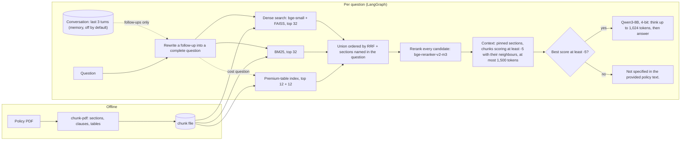

# Insurance Policy RAG

[](https://colab.research.google.com/github/RamkrushnaSaner/insurance-policy-rag/blob/main/notebooks/colab_quickstart.ipynb)

[](LICENSE)

This system answers questions about a health insurance policy (HDFC ERGO **my:Optima Secure**) from the policy text only. It
cites the sections it used. When the text does not cover a question, it replies *"Not specified in the provided policy
text."* Everything runs on open
models on a free Colab T4 GPU, with no API keys. The repository also contains the evaluation that measured the
system and the published results.

> The answers come from a language model. They can be incomplete or wrong, so check them against the policy wording.
> This project does not give insurance advice.

## Results

The system was evaluated on 113 questions written by hand from the policy: 25 for development and 88 held out for
decisions, with 19 questions the policy does not answer and 32 in everyday wording. An answer counts as **fully correct**
when it contains every key fact, has no critical error (a wrong table value, a known false statement, another cover's
rule, a figure that is not in the context, a wrong yes/no) and is not cut off. For a not-answerable question it must
say at the start that the policy does not cover it.

| Measure | Held-out test (88) | All (113) |
|---|---|---|
| **Fully correct** | **79/88 = 89.8%** (95% CI 82–95%) | 97/113 = 85.8% (95% CI 78–91%) |
| Critical errors | 1 of 88 | 2 of 113 (1.8%) |
| Not-answerable questions declined | 15/15 | 18/19 |
| Answerable questions refused | 3 of 73 (4.1%) | 4 of 94 (4.3%) |
| Answers with a figure that is not in the context | 0 | 0 |
| Groundedness (HHEM: share of answer sentences supported by the context) | 0.892 | 0.886 |
| Answers with at least one sentence HHEM does not support | 25.6% | 28.3% |
| Evidence among the search candidates / reaching the model | 0.99 / 0.93 | 0.98 / 0.92 |
| Seconds per answer on a T4 (median / 95th percentile) | 46 / 116 | 47 / 131 |
| Peak GPU memory | | 10.3 GB |

**Where it is weaker.** Only 20 of the 28 answerable everyday-wording questions were fully correct, against 59 of 66 in
policy wording. In 8 of the 16 failures the evidence never reached the model: the search missed it, it scored below
the reranker floor, or other passages filled the context first. The other 8 are answers that left out a fact or drew a
wrong conclusion. [docs/evaluation.md](docs/evaluation.md) lists every failure, and
[results/baseline/](results/baseline/) has the full scorecard and the verdict for each question.

### Experiments

| Experiment | Result | Decision | Evidence |
|---|---|---|---|
| Baseline (above) | 79/88 fully correct on test | the published system | [results/baseline/](results/baseline/) |
| v2.6 (Mistral-7B, text chunks) against v3.1, 24 dev questions | 11 → 17 fully correct, 6 fixed, 0 broken (p = 0.031) | v3 kept | [results/v2_6_vs_v3_1/](results/v2_6_vs_v3_1/) |
| Thinking off | 72/88 on test: 7 lost, 0 gained (p = 0.016); median 9.5 s instead of 47.4 s | keep thinking on | [results/thinking_off/](results/thinking_off/) |
| Conversation memory, three runs | never significantly better (final run: 21 vs 19 of 32 follow-ups, p = 0.73) | off by default | [results/memory/](results/memory/) |
| Reproduction on a T4, three sessions | identical contexts, prompts, verdicts and groundedness each time | – | [results/reproduction/](results/reproduction/) |
| Qwen3 embeddings from Neon (pgvector), text-only chunks | all evidence in context 64/67 for both embedders; dense recall@10 0.955 → 0.993 | keep Qwen3 | [results/embedder_qwen3/](results/embedder_qwen3/) |
| Table route (typed tables in Postgres), retrieval | table-only questions with every key fact in context 0/12 → 12/12; nothing lost elsewhere | tables on | [results/table_route_retrieval/](results/table_route_retrieval/) |
| **Neon + table route, full answers (v3.4)** | 78/88 on test against 79/88 (5 fixed, 6 broken, p = 1.0); 100/113 overall | adopted: not worse, not shown better | [results/neon_tables/](results/neon_tables/) |
| R1 (a search card for every table row) against v3.4, fresh v3: 107 unseen questions, graded by the checks | 94 vs 88 fully correct; table questions 26 vs 18 (9 fixed, 1 broken, p = 0.02); the checks agreed with a person on 30 answers at kappa 0.52, below the 0.7 required | not adopted: the check on the checks failed | [docs/experiments.md](docs/experiments.md#10-r1-table-cards-on-fresh-v3) |
| **R1 against v3.4, final round, fresh v4: 88 unseen questions, the deciding answers judged by a person** | table questions 24 vs 20 (6 fixed, 2 broken, p = 0.29); text questions 42 vs 40; unanswerable questions declined 8/8 for both | **not adopted: v3.4 stays.** The project's last decision | [docs/experiments.md](docs/experiments.md#11-final-round-r1-against-v34-on-fresh-v4) |

**v3.4: the database version.** The same answer model, reranker and prompt, with the search moved to Postgres on Neon
(Qwen3 vectors over text-only chunks) and the printed tables stored as typed tables answered with fixed SQL
([`configs/experiments/qwen3_text_tables.yaml`](configs/experiments/qwen3_text_tables.yaml), schema in [`db/`](db/)).
On the 88 test questions it is not significantly different from the baseline above (78 against 79); it puts more of
the evidence in front of the model (all evidence for 66 of 67 test questions against 63) and traces every table value
to its printed cell. The table above and [results/neon_tables/](results/neon_tables/) give the details and the
limits. `configs/default.yaml` stays the published baseline, which needs no database.

**The last candidate, R1, was not adopted.** R1 adds a search card for every row of every printed table (code on the
branch `r1-candidate`). It was judged twice on questions written after it was built, under rules fixed and
fingerprinted before any answer existed. On both sets it removed every failure where a fact printed only in a table
never reached the model (6 → 0 and 7 → 0). The answers improved too, but not by enough: on fresh v3 the checks could
not be trusted (they passed a clearly wrong answer), and on fresh v4, judged by a person, the gain on table questions
(6 fixed, 2 broken) was not significant; 10 fixed against 2 broken would have been needed. So v3.4 stays, and the
remaining failures are the same in both systems: evidence that ranks too low or does not fit in the context, and
answers that hedge or leave out a fact.

[docs/experiments.md](docs/experiments.md) explains each experiment (objective, method, result, limitations) and lists
what has not been run or cannot be verified. Every result folder names the private run file it was built from
(sha256), and [`tests/test_published_results.py`](tests/test_published_results.py) recomputes the headline numbers from
the published files.

**How far to trust these numbers**

- **Where the answers came from:** they were generated once on Colab with the v3.1 notebook, then re-scored with the
  corrected checks in this repository (v3.1's own checks gave 93/113; the corrections fixed five false failures and
  one missed false statement). In three later sessions on a T4, the package rebuilt the same contexts and prompts for
  all 113 questions and gave the same verdicts and groundedness each time
  ([results/reproduction/](results/reproduction/)). The answers themselves have not been regenerated by the package.
- **Who checked the checks:** the automatic verdicts agree with a reading of all 113 answers during development, by
  the AI assistant that wrote the checks. That reading was not blind or independent. Blind labels by a person exist
  only for the later fresh question sets: 30 answers on fresh v3 (kappa 0.52) and 66 on fresh v4 (same verdict on 55,
  kappa 0.63). The checks' main weakness shows there: they can pass an answer that contains the key words in a
  sentence that denies them.
- **How precise:** 88 test questions can only detect differences of about 15 points between two systems. The
  confidence intervals above are wide for the same reason.
- **Groundedness:** HHEM groundedness is 0.886, and 28% of answers have at least one sentence it does not support.
  HHEM also flags correct paraphrases, so this overstates hallucination. No figure in any answer is missing from its
  context. (Published as 0.851 until 29 October 2026: the v3.1 notebook split answers into sentences differently;
  [details](results/baseline/README.md).)

## How it works



| Stage | What it does | Code |
|---|---|---|
| Chunking (offline) | Reads the PDF's two-column layout, finds numbered sections, lettered clauses and exclusion codes, and turns tables into self-describing lines | [`ingest/optima_secure_pdf.py`](src/policy_rag/ingest/optima_secure_pdf.py) |
| Memory (off by default) | In a conversation, rewrites a follow-up into a complete question from the last 3 turns (one extra model call, thinking on). The answer prompt never contains the conversation. Evaluated three times and not adopted ([evaluation](docs/evaluation.md#conversation-memory)) | [`memory.py`](src/policy_rag/memory.py) |
| Search | Dense ([BGE-small](https://huggingface.co/BAAI/bge-small-en-v1.5)) and BM25 legs, fused by reciprocal rank. Premium tables are a separate index, searched only for cost questions | [`retrieval.py`](src/policy_rag/retrieval.py) |
| Reranking | A cross-encoder ([bge-reranker-v2-m3](https://huggingface.co/BAAI/bge-reranker-v2-m3)) scores every candidate | [`reranking.py`](src/policy_rag/reranking.py) |
| Context | Pins sections whose heading the question names, adds dependent neighbours ("the list below"), keeps a token budget | [`context.py`](src/policy_rag/context.py) |
| Gate | Refuses without calling the model when nothing relevant was found | [`pipeline.py`](src/policy_rag/pipeline.py) |
| Generation | [Qwen3-8B](https://huggingface.co/Qwen/Qwen3-8B) in 4-bit. It thinks first; at the budget it is told to answer. Sampling is seeded from the prompt, and answers are cached | [`generation.py`](src/policy_rag/generation.py), [`prompts.py`](src/policy_rag/prompts.py) |
| Evaluation | Deterministic checks, retrieval metrics, [HHEM-2.1-Open](https://huggingface.co/vectara/hallucination_evaluation_model) groundedness, paired statistics | [`evaluation/`](src/policy_rag/evaluation/) |

[docs/how_it_works.md](docs/how_it_works.md) follows one question through every stage and explains the reasoning
behind each design choice, with the measurements that led to it.

## Quick start

### On Google Colab (free T4 GPU)

Open [`notebooks/colab_quickstart.ipynb`](notebooks/colab_quickstart.ipynb) with the badge above, choose *Runtime →
Change runtime type → T4 GPU* and run the cells. It installs the package, asks for the policy PDF (or your chunk
file), and then lets you ask questions or run the evaluation.

### Locally (Linux with a CUDA GPU, about 16 GB)

```bash
git clone https://github.com/RamkrushnaSaner/insurance-policy-rag.git
cd insurance-policy-rag
python -m venv .venv && source .venv/bin/activate
pip install torch                       # the build for your CUDA version: https://pytorch.org/get-started/locally/
pip install -e ".[models,ingest]"

policy-rag chunk-pdf path/to/prospectus.pdf data/policy_chunks.json   # see data/README.md
policy-rag ask "What is the waiting period for pre-existing diseases?"
policy-rag chat                         # ask several questions in a row; /help lists the commands
```

The first answer downloads the models (roughly 20 GB; an estimate, not measured). From Python:

```python
from policy_rag import RAGSystem

rag = RAGSystem.from_config("configs/default.yaml")
r = rag.ask("Is a knee replacement after a road accident covered in the first year?")
r.answer, r.sources, r.route        # the answer, the passages it read, "answer" or "no_answer"

rag.set_memory(True)                # experimental follow-up rewriting (off by default, not adopted)
chat = rag.new_conversation()
rag.ask("What is the waiting period for kidney stones?", conversation=chat)
r = rag.ask("Does it apply if the problem is caused by an accident?", conversation=chat)
r.standalone                        # the complete question that was searched and answered
```

## Evaluate and experiment

```bash
policy-rag evaluate --name baseline                       # all 113 questions: about 2 hours on a T4
policy-rag evaluate --name baseline --splits dev          # 25 questions
policy-rag evaluate --name retr --mode retrieval          # search, rerank and context only: minutes, no answer model
policy-rag evaluate --name check --mode rescore --rescore-from runs/baseline/run.json   # re-check saved answers
```

Each run writes `runs/<name>/`: `report.md`, `results.csv` (every answer next to its reference),
`scorecard.csv`, `run.json` and `labels_to_fill.csv`. Answers are cached by prompt and generation settings, so
repeating a run, or running a variant that changes only retrieval for some questions, generates only what is new.
`--resume-from` reuses the answers of an earlier session: an `answer_cache.jsonl`, a results zip, or a run's
`run.json` (its records hold every generated answer). The cache keys are the same as the v3.1 notebook's, so its
answers can be reused here.

**Conversation memory** has its own evaluation: `policy-rag evaluate-dialogues --name memory` answers the 44
follow-ups in [`testsets/optima_secure_followups.json`](testsets/optima_secure_followups.json) three ways (as typed
without memory, rewritten by memory, and as the complete question) and applies a decision rule fixed in advance. In
three runs memory helped some follow-ups but never significantly (final run: 21 of 32 right with memory, 19 without;
5 fixed, 3 broken), so it is **switched off by default**. The write-up is in
[docs/evaluation.md](docs/evaluation.md#conversation-memory).


[`testsets/optima_secure_hard_questions.json`](testsets/optima_secure_hard_questions.json) has 15 harder questions
(calculations, combined conditions, traps) with expected answers to read side by side. They are not scored
automatically: `policy-rag ask --questions-file testsets/optima_secure_hard_questions.json --out runs/hard.csv`.

To run an experiment, change one thing in a config ([`configs/experiments/`](configs/experiments/)), or override a
setting on the command line, then compare with the baseline on the held-out split:

```bash
policy-rag evaluate --name budget_1536 --set generator.think_budget=1536
policy-rag compare runs/baseline/run.json runs/budget_1536/run.json --splits test
```

`compare` re-scores both runs with the same checks and runs McNemar's exact test on "fully correct", with paired
bootstrap intervals for the other metrics. It then applies the decision rule fixed in the config (`decision`): adopt
only if fully correct is significantly better on test, groundedness and abstention are not worse, and the median
answer time and peak GPU memory stay within budget. Models, prompt templates and whole components can be swapped
through the config; see [docs/extending.md](docs/extending.md).

## Project layout

```
insurance-policy-rag/
├── src/policy_rag/
│   ├── config.py          typed configuration (YAML, "extends", --set overrides)
│   ├── corpus.py          chunk files -> documents, sections, chunks (several documents supported)
│   ├── retrieval.py       dense + BM25 search, routed indexes, reciprocal rank fusion
│   ├── reranking.py       cross-encoder reranker
│   ├── context.py         title pinning, neighbour expansion, token budget, passage formatting
│   ├── prompts.py         prompt templates and the refusal text
│   ├── generation.py      answer model (two-phase thinking), answer cache
│   ├── memory.py          conversation memory: follow-up rewriting, conversations
│   ├── chat.py            the interactive chat loop
│   ├── pipeline.py        LangGraph pipeline and the RAGSystem entry point
│   ├── database.py        read-only Postgres session, stored-vector (pgvector) search
│   ├── tables.py          the table route: typed tables, fixed SQL, checks, traced values
│   ├── registry.py        component types selected by name in the config
│   ├── cli.py             the policy-rag command
│   ├── ingest/            PDF -> chunk file for the my:Optima Secure layout
│   └── evaluation/        test set, checks, groundedness, runner, report, statistics, comparison
├── configs/               default.yaml (the baseline), experiments/, a two-policy template
├── testsets/              the 113-question test set, follow-up dialogues (44, plus 2 practice sets), 15 hard questions
├── results/              published evidence, scores only: baseline/, thinking_off/, v2_6_vs_v3_1/, memory/,
│                          reproduction/, embedder_qwen3/, table_route_retrieval/, neon_tables/
├── db/                    the Postgres + pgvector schema (migrations; no policy text)
├── scripts/               export_results.py: rebuilds results/ from private run files
├── notebooks/             Colab quick start; archive/ = the single-notebook version (v3.2)
├── tests/                 234 tests with stand-in components and the published results (no GPU, no downloads;
│                          41 of them need a Postgres, run in CI)
├── docs/                  how it works, evaluation, experiments, adding a policy, extending
└── data/                  your chunk file goes here (not in git; see data/README.md)
```

## Several policies

Each chunk file is a document with its own id (`documents` in the config). Section numbers, title pinning and
neighbour expansion are kept separate per document, and a question can be limited to some documents
(`--document <id>`, or `rag.ask(q, documents=[...])`). With more than one document loaded, every passage label starts
with the policy name and the prompt gets one extra rule: answer for the policy the question names, and say which
policy each statement comes from. With a single document the prompt is exactly the published one.
[`configs/two_policies.example.yaml`](configs/two_policies.example.yaml) is a template.

What is **not** there yet:

- a chunker for other PDF layouts (each insurer's documents need their own, writing the same fields; see
  [docs/adding_a_policy.md](docs/adding_a_policy.md));
- a test set for a second policy;
- any evaluation of choosing between policies. All results above are for one policy.

## Hardware and reproducibility

| | |
|---|---|
| GPU | Tested on a Tesla T4 (16 GB, free Colab). The published run used 7.9 GB of GPU memory after loading its models and peaked at 10.3 GB (Qwen3-8B in 4-bit NF4, the reranker in fp16, HHEM). 4-bit loading needs a CUDA GPU (bitsandbytes). |
| CPU only | Chunking, retrieval-only evaluation, re-scoring and the tests run without a GPU. Generating answers on a CPU is impractically slow. |
| Downloads | Public Hugging Face models on the first run (roughly 20 GB, an estimate); no account or token needed. |
| Same answers again | Sampling is seeded from each prompt, so a prompt gives the same answer on the same hardware and software. The published run's repeat check regenerated an answer identically, and its retrieval was identical when repeated (113/113). Three later T4 sessions rebuilt the same 113 contexts and prompts ([results/reproduction/](results/reproduction/)). Other GPUs or library versions may change answers. |
| Versions | [`requirements-lock.txt`](requirements-lock.txt) lists the exact versions of the published run. Model revisions were not recorded in that run; new runs record them in `run.json`. |
| Fingerprints | Every run records the chunk file's sha256, the test-set version (`7313dd7571` for the published scores) and the config. |

## Limitations

- **One policy evaluated.** The test set, the plan-table check and the chunker are specific to my:Optima Secure. How
  well the system works on another policy is unmeasured.
- **A small test set.** It has 113 questions, 88 of them held out, so the confidence intervals are wide and small
  improvements cannot be shown.
- **Rule-based checks.** The checks match text against answer keys with alternative phrasings. They look for the key
  words, not for what the answer claims, so an answer that denies a key fact in the key fact's own words can pass.
  Against a person's blind labels they agreed at kappa 0.52 (fresh v3, 30 answers) and 0.63 (fresh v4, 66 answers).
- **Table questions on unseen wording.** In v3.4, questions about the printed tables are answered by hand-written
  patterns (the table route). On the two fresh sets they missed a fact printed only in a table 6 times (of 29 table
  questions) and 7 times (of 30). R1's table cards fixed that in search, but were not adopted (above).
- **Context selection.** Evidence that scores below the reranker floor is never read, even with budget left, and when
  a question names more than two section titles, the two pinned first are chosen by document order, not relevance.
  Both were seen on development questions and left unchanged: fixing them for the questions that showed them would
  have been tuning on those questions.
- **Who wrote the questions.** The fresh question sets v1–v4 and their reference answers were written by the AI
  assistant from the policy. A person judged the deciding answers of the final round, not every key.
- **The policy contradicts itself in places**, so some questions have no single right answer. The Optima Super
  Secure premium table prints a Rs. 5 lakh column although Annexure A starts that plan at Rs. 10 lakh, and Section
  10.2 o excludes crutches, while Annexure B lists walking aids among the non-medical items that the Protect
  Benefit pays.
- **Everyday wording is weaker** than policy wording (above). Some evidence scores below the reranker floor of −5,
  which was set in v2 for a different reranker and has not been recalibrated.
- **Latency.** Thinking makes answers slow: a median of 47 s per answer on a T4.
- **English only.** Prompts, checks and test questions are all in English.
- **No conversation memory by default.** Rewriting follow-ups into complete questions was built and evaluated three
  times, but never helped significantly: the rewriter (Qwen3-8B) too often picked the wrong referent for "it" or
  "that". Memory is off, so each question is answered as typed: name what you ask about. It can be switched on for
  experiments (`--set memory.enabled=true`); each follow-up then costs one extra model call with thinking (a median
  of 44 s on a T4). A wrong rewrite leads to a wrong
  search, which is why the rewritten question is always shown. Conversations live in
  memory (save them with `/save`), and the answer step never sees the conversation, so requests about the chat itself
  ("summarise what you told me") are not supported.

### Not done

Ideas that came out of the last evaluations and were deliberately not built. Each would need its own unseen question
set and rules fixed before running it.

- **Table lookup by form:** the model fills a small form (plan, age, Sum Insured, tier) whose fields must be values
  that exist in the database, and fixed, tested queries return the numbers. It would replace the hand-written
  patterns for numeric tables; search cards would stay for lists such as Annexure B.
- **Context selection:** the reading budget, the reranker floor and the pinning tie-break above.
- **Answer writing:** hedged openings and answers that leave out a fact that was in the context.
- **The checks:** check what an answer asserts, not only which words it contains.

### What is tuned by hand

Nothing returns a stored answer: every answer is generated from retrieved text. The only fixed output is the refusal
sentence. Several rules were written by hand for this document and are applied without being learned:

| Where | What |
|---|---|
| Runtime | The premium-routing patterns (in the config), title-pinning stopwords, the "provided below" pointer rule, thresholds and budgets, and the prompt's scope rules |
| Chunker (offline) | Page-layout constants (header/footer bands, column gutter), heading, clause and exclusion patterns, table detection by plan names, MAX/HARD token sizes |
| Evaluation | The test set, the plan-table checker (plan names, Section 2.1 values) and the evidence-removed question list |

## History

- **v3.3.1 (this version):** all experiments re-verified against their run files; evidence for each in `results/`
  with `scripts/export_results.py` and a test that recomputes the headline numbers; groundedness corrected to the
  package's measurement (0.886). See [docs/experiments.md](docs/experiments.md).
- **v3.3:** `policy-rag chat`; conversation memory (follow-up rewriting) built and evaluated three
  times with follow-up dialogue test sets and `evaluate-dialogues`, and not adopted, so it is off by default;
  resuming from a saved run. Single questions are handled exactly as in v3.2 (confirmed on a T4). See [CHANGELOG.md](CHANGELOG.md).
- **v3.2:** the system as a Python package with configs, a command line, tests and docs. Its answers
  are the same as the v3.1 notebook's, verified as described above. The single-notebook version is kept in
  [`notebooks/archive/`](notebooks/archive/).
- **v3.1 / v3.2 notebooks:** chunk file from the PDF, the bge-reranker-v2-m3 reranker, Qwen3-8B with budgeted
  thinking, a separate premium index, the 113-question test set with dev/test splits, and HHEM.
- **v2.x:** an earlier text-file pipeline with Mistral-7B, not part of this repository (compared in [docs/evaluation.md](docs/evaluation.md#compared-with-the-v26-baseline)).

## License

The code is released under the [MIT License](LICENSE). The models download from Hugging Face under their own licenses:
bge-small-en-v1.5 (MIT), bge-reranker-v2-m3, Qwen3-8B and HHEM-2.1-Open (Apache 2.0). The my:Optima Secure policy
document belongs to HDFC ERGO General Insurance Company Limited and is not distributed with this repository. The test
set contains short phrases quoted from it as answer keys.
