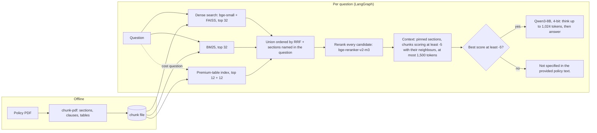

# Insurance Policy RAG

[](https://colab.research.google.com/github/RamkrushnaSaner/insurance-policy-rag/blob/main/notebooks/colab_quickstart.ipynb)

[](LICENSE)

This system answers questions about a health insurance policy (HDFC ERGO **my:Optima Secure**) from the policy text only. It
cites the sections it used. When the text does not cover a question, it replies *"Not specified in the provided policy
text."* Everything runs on open models on a free Colab T4 GPU, with no API keys. The repository also contains the
evaluation that measured the system and the published results.

> The answers come from a language model. They can be incomplete or wrong, so check them against the policy wording.
> This project does not give insurance advice.

## Results

The system was evaluated on 113 questions written by hand from the policy: 25 for development and 88 held out for
decisions, with 19 questions the policy does not answer and 32 in everyday wording. An answer counts as **fully correct**
when it contains every key fact, has no critical error (a wrong table value, a known false statement, another cover's
rule, a figure that is not in the context, a wrong yes/no) and is not cut off. For a not-answerable question it must
say at the start that the policy does not cover it.

| Measure | Held-out test (88) | All (113) |
|---|---|---|
| **Fully correct** | **79/88 = 89.8%** (95% CI 82–95%) | 97/113 = 85.8% (95% CI 78–91%) |
| Critical errors | 1 of 88 | 2 of 113 (1.8%) |
| Not-answerable questions declined | 15/15 | 18/19 |
| Answerable questions refused | 3 of 73 (4.1%) | 4 of 94 (4.3%) |
| Answers with a figure that is not in the context | 0 | 0 |
| Evidence among the search candidates / reaching the model | 0.99 / 0.93 | 0.98 / 0.92 |
| Seconds per answer on a T4 (median / 95th percentile) | 46 / 116 | 47 / 131 |
| Peak GPU memory | | 10.3 GB |

**Where it is weaker.** Only 20 of the 28 answerable everyday-wording questions were fully correct, against 59 of 66 in
policy wording. In 8 of the 16 failures the evidence never reached the model: the search missed it, it scored below
the reranker floor, or other passages filled the context first. The other 8 are answers that left out a fact or drew a
wrong conclusion. [docs/evaluation.md](docs/evaluation.md) lists every failure, and
[results/baseline/](results/baseline/) has the full scorecard and the verdict for each question.

**How far to trust these numbers**

- **Where the answers came from:** they were generated once on Colab with the v3.1 notebook, then re-scored with the
  corrected checks in this repository (the corrections fixed false alarms and missed errors in v3.1's checks). The
  package's code was verified to reproduce that notebook exactly ([docs/evaluation.md](docs/evaluation.md#verification)).
  It has not yet been rerun end to end on a GPU.
- **Who checked the checks:** the automatic verdicts agree with a manual review of all 113 answers made during
  development. That review was not blind, and independent human labels (`policy-rag agreement`) are still to be
  collected.
- **How precise:** 88 test questions can only detect differences of about 15 points between two systems. The
  confidence intervals above are wide for the same reason.
- **Groundedness:** HHEM groundedness is 0.85, and 34% of answers have at least one sentence it does not support.
  HHEM also flags correct paraphrases, so this overstates hallucination. No figure in any answer is missing from its
  context.

## How it works



| Stage | What it does | Code |
|---|---|---|
| Chunking (offline) | Reads the PDF's two-column layout, finds numbered sections, lettered clauses and exclusion codes, and turns tables into self-describing lines | [`ingest/optima_secure_pdf.py`](src/policy_rag/ingest/optima_secure_pdf.py) |
| Search | Dense ([BGE-small](https://huggingface.co/BAAI/bge-small-en-v1.5)) and BM25 legs, fused by reciprocal rank. Premium tables are a separate index, searched only for cost questions | [`retrieval.py`](src/policy_rag/retrieval.py) |
| Reranking | A cross-encoder ([bge-reranker-v2-m3](https://huggingface.co/BAAI/bge-reranker-v2-m3)) scores every candidate | [`reranking.py`](src/policy_rag/reranking.py) |
| Context | Pins sections whose heading the question names, adds dependent neighbours ("the list below"), keeps a token budget | [`context.py`](src/policy_rag/context.py) |
| Gate | Refuses without calling the model when nothing relevant was found | [`pipeline.py`](src/policy_rag/pipeline.py) |
| Generation | [Qwen3-8B](https://huggingface.co/Qwen/Qwen3-8B) in 4-bit. It thinks first; at the budget it is told to answer. Sampling is seeded from the prompt, and answers are cached | [`generation.py`](src/policy_rag/generation.py), [`prompts.py`](src/policy_rag/prompts.py) |
| Evaluation | Deterministic checks, retrieval metrics, [HHEM-2.1-Open](https://huggingface.co/vectara/hallucination_evaluation_model) groundedness, paired statistics | [`evaluation/`](src/policy_rag/evaluation/) |

[docs/how_it_works.md](docs/how_it_works.md) follows one question through every stage and explains the reasoning
behind each design choice, with the measurements that led to it.

## Quick start

### On Google Colab (free T4 GPU)

Open [`notebooks/colab_quickstart.ipynb`](notebooks/colab_quickstart.ipynb) with the badge above, choose *Runtime →
Change runtime type → T4 GPU* and run the cells. It installs the package, asks for the policy PDF (or your chunk
file), and then lets you ask questions or run the evaluation.

### Locally (Linux with a CUDA GPU, about 16 GB)

```bash
git clone https://github.com/RamkrushnaSaner/insurance-policy-rag.git
cd insurance-policy-rag
python -m venv .venv && source .venv/bin/activate
pip install torch                       # the build for your CUDA version: https://pytorch.org/get-started/locally/
pip install -e ".[models,ingest]"

policy-rag chunk-pdf path/to/prospectus.pdf data/policy_chunks.json   # see data/README.md
policy-rag ask "What is the waiting period for pre-existing diseases?"
```

The first answer downloads about 20 GB of models. From Python:

```python
from policy_rag import RAGSystem

rag = RAGSystem.from_config("configs/default.yaml")
r = rag.ask("Is a knee replacement after a road accident covered in the first year?")
r.answer, r.sources, r.route        # the answer, the passages it read, "answer" or "no_answer"
```

## Evaluate and experiment

```bash
policy-rag evaluate --name baseline                       # all 113 questions: about 2 hours on a T4
policy-rag evaluate --name baseline --splits dev          # 25 questions
policy-rag evaluate --name retr --mode retrieval          # search, rerank and context only: minutes, no answer model
policy-rag evaluate --name check --mode rescore --rescore-from runs/baseline/run.json   # re-check saved answers
```

Each run writes `runs/<name>/`: `report.md`, `results.csv` (every answer next to its reference),
`scorecard.csv`, `run.json` and `labels_to_fill.csv`. Answers are cached by prompt and generation settings, so
repeating a run, or running a variant that changes only retrieval for some questions, generates only what is new.
`--resume-from answer_cache.jsonl` reuses the answers of an earlier session. The cache keys are the same as the v3.1
notebook's, so its answer cache can be reused here.

[`testsets/optima_secure_hard_questions.json`](testsets/optima_secure_hard_questions.json) has 15 harder questions
(calculations, combined conditions, traps) with expected answers to read side by side. They are not scored
automatically: `policy-rag ask --questions-file testsets/optima_secure_hard_questions.json --out runs/hard.csv`.

To run an experiment, change one thing in a config ([`configs/experiments/`](configs/experiments/)), or override a
setting on the command line, then compare with the baseline on the held-out split:

```bash
policy-rag evaluate --name budget_1536 --set generator.think_budget=1536
policy-rag compare runs/baseline/run.json runs/budget_1536/run.json --splits test
```

`compare` re-scores both runs with the same checks and runs McNemar's exact test on "fully correct", with paired
bootstrap intervals for the other metrics. It then applies the decision rule fixed in the config (`decision`): adopt
only if fully correct is significantly better on test, groundedness and abstention are not worse, and the median
answer time and peak GPU memory stay within budget. Models, prompt templates and whole components can be swapped
through the config; see [docs/extending.md](docs/extending.md).

## Project layout

```
insurance-policy-rag/
├── src/policy_rag/
│   ├── config.py          typed configuration (YAML, "extends", --set overrides)
│   ├── corpus.py          chunk files -> documents, sections, chunks (several documents supported)
│   ├── retrieval.py       dense + BM25 search, routed indexes, reciprocal rank fusion
│   ├── reranking.py       cross-encoder reranker
│   ├── context.py         title pinning, neighbour expansion, token budget, passage formatting
│   ├── prompts.py         prompt templates and the refusal text
│   ├── generation.py      answer model (two-phase thinking), answer cache
│   ├── pipeline.py        LangGraph pipeline and the RAGSystem entry point
│   ├── registry.py        component types selected by name in the config
│   ├── cli.py             the policy-rag command
│   ├── ingest/            PDF -> chunk file for the my:Optima Secure layout
│   └── evaluation/        test set, checks, groundedness, runner, report, statistics, comparison
├── configs/               default.yaml (the baseline), experiments/, a two-policy template
├── testsets/              the 113-question test set and 15 extra hard questions
├── results/baseline/      the published scorecard and per-question verdicts (scores only)
├── notebooks/             Colab quick start; archive/ = the single-notebook version (v3.2)
├── tests/                 31 tests with stand-in components (no GPU, no downloads, no policy text)
├── docs/                  how it works, evaluation, adding a policy, extending
└── data/                  your chunk file goes here (not in git; see data/README.md)
```

## Several policies

Each chunk file is a document with its own id (`documents` in the config). Section numbers, title pinning and
neighbour expansion are kept separate per document, and a question can be limited to some documents
(`--document <id>`, or `rag.ask(q, documents=[...])`). With more than one document loaded, every passage label starts
with the policy name and the prompt gets one extra rule: answer for the policy the question names, and say which
policy each statement comes from. With a single document the prompt is exactly the published one.
[`configs/two_policies.example.yaml`](configs/two_policies.example.yaml) is a template.

What is **not** there yet:

- a chunker for other PDF layouts (each insurer's documents need their own, writing the same fields; see
  [docs/adding_a_policy.md](docs/adding_a_policy.md));
- a test set for a second policy;
- any evaluation of choosing between policies. All results above are for one policy.

## Hardware and reproducibility

| | |
|---|---|
| GPU | Tested on a Tesla T4 (16 GB, free Colab). Peak use was 10.3 GB: Qwen3-8B in 4-bit NF4 (about 6.5 GB), the reranker in fp16 and HHEM in fp32. 4-bit loading needs a CUDA GPU (bitsandbytes). |
| CPU only | Chunking, retrieval-only evaluation, re-scoring and the tests run without a GPU. Generating answers on a CPU is impractically slow. |
| Downloads | About 20 GB of public Hugging Face models on the first run; no account or token needed. |
| Same answers again | Sampling is seeded from each prompt, so a prompt gives the same answer on the same hardware and software. The published run's repeat check regenerated an answer identically, and its retrieval was identical when repeated (113/113). Other GPUs or library versions may change answers. |
| Versions | [`requirements-lock.txt`](requirements-lock.txt) lists the exact versions of the published run. Model revisions were not recorded in that run; new runs record them in `run.json`. |
| Fingerprints | Every run records the chunk file's sha256, the test-set version (`7313dd7571` for the published scores) and the config. |

## Limitations

- **One policy evaluated.** The test set, the plan-table check and the chunker are specific to my:Optima Secure. How
  well the system works on another policy is unmeasured.
- **A small test set.** It has 113 questions, 88 of them held out, so the confidence intervals are wide and small
  improvements cannot be shown.
- **Rule-based checks.** The checks match text against answer keys with alternative phrasings. They have been
  reviewed, but not yet validated against independent human labels.
- **Everyday wording is weaker** than policy wording (above). Some evidence scores below the reranker floor of −5,
  which was set in v2 for a different reranker and has not been recalibrated.
- **Latency.** Thinking makes answers slow: a median of 47 s per answer on a T4.
- **English only.** Prompts, checks and test questions are all in English.

### What is tuned by hand

Nothing returns a stored answer: every answer is generated from retrieved text. The only fixed output is the refusal
sentence. Several rules were written by hand for this document and are applied without being learned:

| Where | What |
|---|---|
| Runtime | The premium-routing patterns (in the config), title-pinning stopwords, the "provided below" pointer rule, thresholds and budgets, and the prompt's scope rules |
| Chunker (offline) | Page-layout constants (header/footer bands, column gutter), heading, clause and exclusion patterns, table detection by plan names, MAX/HARD token sizes |
| Evaluation | The test set, the plan-table checker (plan names, Section 2.1 values) and the evidence-removed question list |

## History

- **v3.2 (this version):** the system as a Python package with configs, a command line, tests and docs. Its answers
  are the same as the v3.1 notebook's, verified as described above. The single-notebook version is kept in
  [`notebooks/archive/`](notebooks/archive/).
- **v3.1 / v3.2 notebooks:** chunk file from the PDF, the bge-reranker-v2-m3 reranker, Qwen3-8B with budgeted
  thinking, a separate premium index, the 113-question test set with dev/test splits, and HHEM.
- **v2.x:** an earlier text-file pipeline with Mistral-7B, not part of this repository (compared in [docs/evaluation.md](docs/evaluation.md#compared-with-the-v26-baseline)).

## License

The code is released under the [MIT License](LICENSE). The models download from Hugging Face under their own licenses:
bge-small-en-v1.5 (MIT), bge-reranker-v2-m3, Qwen3-8B and HHEM-2.1-Open (Apache 2.0). The my:Optima Secure policy
document belongs to HDFC ERGO General Insurance Company Limited and is not distributed with this repository. The test
set contains short phrases quoted from it as answer keys.
